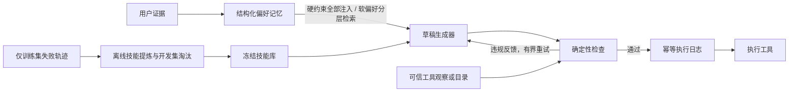

# Training-Free Personalized Service Agent on VitaBench 2.0

面向外卖、到店、旅行服务的**无需模型训练**的 Agent 研究原型。实现 draft → check → regenerate、带证据的偏好记忆，以及从失败轨迹离线提炼和冻结的技能库。

对接官方 [meituan-longcat/VitaBench-2.0](https://github.com/meituan-longcat/VitaBench-2.0)，接口版本固定为 `f60169e89f30499cb7883f3dad76bd03facc908d`。本项目没有复现简历中的 `0.440 → 0.570`、`+8.6%` 成本、`0.38 → 0.48` 或 `4.6pp`；这些数值需要独立、可复现的正式实验。

## 立即运行

Python 3.10+。核心实现仅依赖标准库，不需要 API 密钥、GPU、向量数据库或模型下载。

```bash
python3 -m venv .venv
source .venv/bin/activate
python -m pip install -e '.[dev]'
python -m vita_agent demo
python -m pytest -q
```

`demo` 创建独立的 `artifacts/demo-*` 目录，生成完整轨迹 `report.json` 和只读技能快照 `skills.frozen.json`。也可使用 `--output <空目录>`；已有文件不会被覆盖。

演示使用本地模拟服务与固定草稿序列：

- 外卖预算从 60 更新为 30，旧值保留为 superseded；花生过敏是独立硬约束。
- 高价沙拉被预算检查拦截，花生面被过敏检查拦截，最后执行米饭套餐。
- 酒店退房早于入住的草稿被拦截，修正日期后执行。
- 从训练失败记录产生任务级和步骤级技能，演示效用淘汰，再冻结用于推理。

它验证控制流程，不衡量 LLM 能力，也不产生 VitaBench 分数。模拟环境不会下真实订单。

## 实现结构



| 模块 | 实现 | 边界 |
|---|---|---|
| `harness.py` / `guards.py` | 校验预算、过敏原、日期、数量、库存、容量和必填字段；官方适配器对未知事实 fail-open、对明确违反 fail-closed；检查酒店品牌/电话叫醒；未支付订单阻止“完成”声明；限制重生成；SQLite 幂等日志 | 事实由可信 resolver 提供；模型草稿不能自报价格作为证据；真实服务仍需原子校验和幂等支持 |
| `memory.py` / `semantic_memory.py` | SQLite slot memory；引用和时间证据；supersede 覆盖链；可选 LLM 语义抽取和原始用户证据检索；酒店品牌（排他表达为 hard）与电话叫醒需求 | 未经确定性核实的语义硬约束降为候选；软偏好和原文回退采用词项检索，当前不是 embedding RAG；品牌/设施规则覆盖仍窄 |
| `skills.py` / `skill_reflection.py` | 规则模板提炼、效用淘汰和 SHA-256 冻结；引用训练轨迹证据的 LLM 反思模块；v2 快照已接入统一加载器 | 尚未生成真实 v2 技能库或测得技能收益；没有 grounded 候选时不写快照；不从测试轨迹学习 |
| `vitabench.py` / `official_facts.py` | 官方 `BaseMemory` 插件、受约束 Agent 子类；覆盖 30 个官方写工具的观察事实映射 | 必需事实缺失时拒绝；仅加载记忆插件不会启用执行检查；覆盖工具不代表所有业务规则完备 |
| `experiments.py` / `budget.py` | 固定用户划分、实验计划哈希、五组消融入口、共享额度账本；支持货币、请求数和积分三种模式；按 variant 标记请求 | 免费模式不伪造单价；供应商 429/额度耗尽会 halt 共享 ledger；本地计数不能替代供应商额度 |
| `evaluation.py` | 官方结果配对比较、偏好更新子集、按用户 bootstrap、成本变化 | 缺失 trial/分数拒绝比较；未知成本保留 `null` |

## 编程接口

```python
from vita_agent.memory import PreferenceMemory
from vita_agent.models import Evidence, Action, Proposal
from vita_agent.harness import GuardedHarness
from vita_agent.sandbox import CatalogSandbox, example_catalog

memory = PreferenceMemory("artifacts/preferences.sqlite3")
memory.remember(
    Evidence("message-1", "user-1", "这次外卖预算最多30元", timestamp=1),
    domain="delivery", slot="total_price", value=30,
    strength="hard", operator="lte",
)
service = CatalogSandbox(example_catalog())
harness = GuardedHarness(memory, service.resolve, service.execute)
result = harness.run(
    "user-1", "delivery", "帮我点午餐",
    lambda context, feedback: Proposal(
        Action("order_food", {"product_id": "rice-bowl", "quantity": 1}, "order-request-1")
    ),
)
assert result.status == "executed"
memory.close()
harness.journal.close()
```

真实 planner 接收 `context`（当前请求、偏好、冻结技能）和上一轮 `feedback`，返回 `Proposal`；真实 resolver/executor 应绑定当前认证用户。`executed` 表示 executor 成功返回，业务失败必须由适配器抛出异常。发生执行超时或执行后日志写入失败时标记 `execution_uncertain`，禁止自动重试。

规则偏好抽取支持有限的中英文显式预算、过敏和菜系表达；官方适配器还支持 `VITA_MEMORY_EXTRACTION=llm` 的带原文引用语义抽取。训练数据审计发现，规则仅从 27,762 条去重用户原话中抽取到 1 条，说明规则覆盖很窄；这不是偏好召回率或任务成功率。语义抽取和原文回退已实现，但尚未获得真实记忆消融结果。未知语言模式、没有 speaker 的历史文本、第三方陈述不会自动变成硬约束。手动 `remember()` 验证引用与来源，但调用者负责 slot/value 与原文语义相符。预算不做货币或人均/总额转换；过敏列表的覆盖代表完整列表替换，不自动追加。

## 技能离线演化

```bash
python -m vita_agent distill examples/failed_traces.jsonl \
  --output artifacts/skills.v1.json
```

正式使用时增加 `--heldout test_user_ids.json`，文件为测试用户对应 task ID 的 JSON 数组。每条失败轨迹必须有 `trace_id`、`task_id`、`split="train"`、`success=false`、`domain`、`steps`；示例文件只含手工构造数据。

`SkillBank.record_outcome(skill_id, success, cost, split="dev")` 记录开发集使用结果。效用定义为 `(successes+1)/(trials+2) - 0.5 - mean_cost`，达到最低样本数且低于阈值时淘汰。成本的尺度影响阈值，须在开发集固定。冻结后禁止提炼、更新效用或淘汰；快照不可覆盖，加载校验内容哈希。哈希用于完整性检查，不能证明数据来源或实验划分正确。

LLM 反思生成的是带原文引用校验的 v2 假设快照。`FrozenSkillBank.load()` 同时支持 v1 和 v2，实验计划的 `--skill-bank`、校验和 worker 可直接加载。`scripts/reflect_skills.py` 使用同一额度账本，额度耗尽时不冻结部分结果；真实反思与技能收益尚未完成。

## 官方基准与实验

见 [真实实验入口](docs/experiments.md)、[VitaBench 接入说明](docs/vitabench.md) 和 [评测与消融协议](docs/evaluation.md)。正式调用使用 `scripts/run_experiments.py`，以统一启用预算、脱敏、版本校验及各组一致的上游兼容补丁。官方数据、模型配置与 LLM 推理费用均独立于本地演示。

```bash
python -m vita_agent compare baseline.json candidate.json \
  --output artifacts/comparison.json
```

建议以用户划分 train/dev/test，固定模型、采样、最大步骤、trial 数、数据版本，比较 baseline、仅 harness、仅 memory、仅 frozen skills 和全模块。在线测试用户的私有偏好可按基准协议更新；跨用户技能库在测试前冻结。

免费模型使用请求数或积分额度，而不是 0 单价：

```bash
OPENCODE_API_KEY="<environment only>" \
python scripts/run_experiments.py execute artifacts/free-train-prefix2-v2/plan.json \
  --max-requests 3 --budget-ledger artifacts/free-shared.sqlite3
```

截至 2026-10-27，已完成四轮真实试验：

- 旧 DeepSeek：1 个训练用户、前 2 个子任务、baseline/harness 各 1 trial，两组均 **0.0**。
- 新 OpenCode Go `deepseek-v4.1-flash`：同用户、同 2 子任务、baseline/harness/memory 各 1 trial，三臂均 **0.0**；update 子集均 0.0。
- P0 修正后的 Go dev smoke 两轮（20 步）：1 个 dev 用户、前 2 个子任务，baseline/harness/memory/memory_harness 均 **0.0**。第二轮 `memory_harness` 最终选中精确目标商品“清汤面”（地址正确、25 分钟、非方便面、已支付），但该子任务触发了 `max_steps`，官方 evaluator 因此直接返回 0。
- 第三轮 50 步 dev smoke（同一用户、2 子任务、每臂 1 trial；三个代码状态）：v6 为 0.0/0.0/**0.5**，v7 全 0.0，v8 为 **0.5**/0.0/0.0。拿到 1.0 的两单都是目标商品 `P00083 清汤面`、地址正确、`shipping_time=25.0`、非方便面、已支付。但 baseline 也能拿到 0.5，**不能**把 0.5 归因于 memory_harness；n=1、且三组代码不同，不是受控对比。
- 第四轮完整 dev 配对（11 个 dev 用户 × 2 子任务 × 3 臂 × 1 trial，固定源码 `9632aa0`、50 步）：**baseline 0.409、harness 0.273、memory_harness 0.182**。配对差值 harness−baseline **−0.136**（95% CI [−0.409, +0.182]）、memory_harness−baseline **−0.227**（[−0.500, +0.045]）。**没有提升证据，点估计为负，区间均跨 0。**
- 第五轮提示词/约束隔离（8 个 dev 用户 × 2 子任务 × 2 trials，关闭两种提示词）：**baseline 0.312、guards_plain 0.281、memory_guards_plain 0.281**；配对差值均为 **−0.031**，95% CI 分别为 [−0.125, +0.062] 和 [−0.250, +0.219]。**只加约束检查、以及记忆+检查，都与 baseline 无可检测差异。**

五轮 Go 实验累计 **3,224 请求**，估算约 **7.2783 USD**。工具调用、JSON、106,659 Token 长上下文和 usage 已通过预检。

对第四轮的解释必须谨慎：每臂每用户只有 1 trial，同一用户 B471882 在近乎相同代码上，memory_harness 已出现过 0.5 / 0.0 / 1.0；抽查 instore 失败轨迹，订单都成功执行，只是选错店或商品，不是 guard 拦截。因此不能说“harness 有害”，只能说 **n=1 无法区分机制效应与轨迹波动**，下一步应先做多 trial 方差估计，并把提示词开关与约束检查分开消融。

零分诊断已修正：此前记为“状态满足但 judge 0 分”，复核日志后确认是 **`--max-steps 20` 触发官方过早终止惩罚**（`evaluator.py` 对 `MAX_STEPS` 直接返回 0，不调用 judge）。实验代码现已强制 `max_steps >= 50`，并在 BLOCK/系统提示中给出已观察候选；候选只有在每个硬约束都有可观察证据时才声称满足。官方 `agent_cost` 聚合值缺失，成本增长率保持 `null`。

当前成果适合描述为“实现并测试了上述机制，完成官方接口接入、新模型训练/dev 试跑、零分诊断、一次完整 dev 配对和一次提示词/约束隔离实验（均未显示提升）”。简历中的提升数字仍无实验支持。验证记录见 [verification.md](docs/verification.md)，Go 训练结果见 [reports/2026-10-27-go-train-prefix2](reports/2026-10-27-go-train-prefix2/)，dev smoke 见 [reports/2026-10-27-go-dev-p0-smoke](reports/2026-10-27-go-dev-p0-smoke/) 与 [50 步 dev smoke](reports/2026-10-27-go-dev-50step/)，完整 dev 对比见 [reports/2026-10-27-go-dev-full](reports/2026-10-27-go-dev-full/)，隔离实验见 [reports/2026-10-27-go-dev-plain](reports/2026-10-27-go-dev-plain/)，零分诊断见 [reports/2026-10-27-zero-score-diagnosis](reports/2026-10-27-zero-score-diagnosis/)，额度记录见 [reports/2026-10-27-provider-quota](reports/2026-10-27-provider-quota/)，继续开发见 [HANDOFF.md](HANDOFF.md)。
